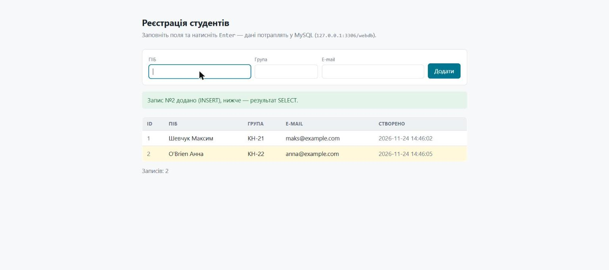

# MySQL Web Lab

Лабораторна робота: вебзастосунок (PHP) з формою, що записує дані в MySQL (`INSERT`)
і показує всі записи (`SELECT`), плюс аналіз трафіку на порту 3306.

**Живий сайт** (працює, поки запущений Codespace):
https://redesigned-spork-gxp6jq64q7jw2p7jv-8080.app.github.dev/



## Як запустити (без встановлення чогось на комп'ютер)

1. Кнопка **Code → Codespaces → Create codespace on main**.
2. Зачекати 2–4 хв, поки зберуться контейнери:
   * `db` — справжній **MySQL 8.0** на порту **3306**; база `webdb` і таблиця `students`
     створюються автоматично з `sql/init.sql`;
   * `app` — PHP 8.3 з вебсервером на порту **8080**, `tcpdump`, `tshark`, `mysql`-клієнт.
3. Вкладка **Ports → 8080 → Open in Browser** — відкриється форма.
   Заповнити поля, натиснути **Enter** — запис додається, нижче таблиця з усіма записами.

Якщо сторінка не відкривається, у терміналі: `php -S 0.0.0.0:8080 -t app &`

## Структура

| Файл | Що це |
|---|---|
| `app/index.php` | сторінка: форма, `INSERT`, `SELECT` (PDO, параметризовані запити) |
| `sql/init.sql` | `CREATE DATABASE webdb`, користувач `webuser`, `CREATE TABLE students` |
| `.devcontainer/` | опис сервера для Codespaces: MySQL + PHP + tcpdump |
| `capture/` | перехоплений трафік (`.pcap` для Wireshark) і його розшифровка |

## Перевірка MySQL з терміналу

```bash
mysql --skip-ssl -h 127.0.0.1 -P 3306 -u webuser -pwebpass webdb -e "SELECT * FROM students;"
```

## Перехоплення трафіку на порту 3306

```bash
# запис у файл для Wireshark (на сторінці в цей час додати запис через форму, потім Ctrl+C)
sudo tcpdump -i lo -nn -s0 -w capture/mysql_3306.pcap 'tcp port 3306 or tcp port 8080'

# одразу побачити SQL-запити в терміналі
sudo tshark -i lo -f 'tcp port 3306' -Y mysql.query -T fields -e mysql.query

# розібрати збережений файл
tshark -r capture/mysql_3306.pcap -Y mysql -O mysql
```

Файл `.pcap` можна завантажити (ПКМ → Download) і відкрити у Wireshark.
Фільтри: `mysql`, `mysql.query`, `mysql.login_request`; ПКМ → *Follow → TCP Stream*.

## Як це працює «під капотом»

```
Браузер ──HTTP POST /──► PHP (порт 8080) ──TCP──► MySQL (порт 3306)
                           │  1. Server Greeting   (версія, випадковий scramble)
                           │  2. Login Request     (user, db, SHA1-хеш — НЕ пароль)
                           │  3. OK
                           │  4. COM_QUERY "INSERT INTO students ..."
                           │  5. OK affected_rows=1, last_insert_id=N
                           │  6. COM_QUIT
Браузер ◄─303 Redirect──  PHP
Браузер ──HTTP GET /───► PHP ──► MySQL: COM_QUERY "SELECT ..."
                                  ◄── Result Set: колонки + рядки + EOF
Браузер ◄─200 OK + HTML── PHP
```

1. **Браузер** при натисканні Enter відправляє форму (`POST`, поля в кодуванні
   `application/x-www-form-urlencoded`).
2. **PHP** отримує `$_POST`, відкриває TCP-з'єднання з MySQL на `127.0.0.1:3306`.
3. **Протокол MySQL**: кожен пакет = `[3 байти довжина][1 байт номер][дані]`.
   Пароль не передається — лише хеш від пароля й випадкового `scramble` сервера.
   Але SQL-запити й дані йдуть **відкритим текстом** (TLS вимкнено для лабораторної),
   тому їх видно у Wireshark.
4. **MySQL** виконує `INSERT` і відповідає `OK`. PHP робить редирект (Post/Redirect/Get),
   браузер запитує сторінку знову, PHP виконує `SELECT` і отримує *Result Set*.
5. PHP перетворює рядки на HTML-таблицю й повертає браузеру.

## Що показало перехоплення (справжній MySQL 8.0.46)

Файли в `capture/`: `mysql_3306.pcap` (для Wireshark), `mysql_3306_decoded.txt`
(короткий список пакетів), `mysql_3306_details.txt` (повний розбір кожного пакета).

SQL-запити, які пройшли через порт 3306 (`tshark -Y mysql.query`):

```
INSERT INTO students (full_name, group_name, email) VALUES ('Шевчук Максим', 'КН-21', 'maks@example.com')
SELECT id, full_name, group_name, email, created_at FROM students ORDER BY id
INSERT INTO students (full_name, group_name, email) VALUES ('O\'Brien Анна', 'КН-22', 'anna@example.com')
SELECT id, full_name, group_name, email, created_at FROM students ORDER BY id
```

Одне з'єднання PHP → MySQL (`mysql_3306_decoded.txt`, кадр | порт від | порт до | що це):

```
89  | 3306  | 46582 | Server Greeting  proto=10 version=8.0.46
91  | 46582 | 3306  | Login Request  user=webuser db=webdb
93  | 3306  | 46582 | Auth Switch Request
94  | 46582 | 3306  | Auth Switch Response
95  | 3306  | 46582 | Response OK
96  | 46582 | 3306  | Request Query      ← INSERT
97  | 3306  | 46582 | Response OK        ← affected_rows = 1
98  | 46582 | 3306  | Request Quit
```

**Auth Switch.** У MySQL 8 метод автентифікації за замовчуванням — `caching_sha2_password`,
тому в Greeting сервер пропонує саме його. Але користувач `webuser` створений з
`mysql_native_password`, тож сервер відповідає *Auth Switch Request* і надсилає новий
scramble, а клієнт повторно рахує хеш (*Auth Switch Response*). Пароль відкритим
текстом не передається ніколи.

Безпека: значення з форми передаються як параметри (`prepare`/`execute`), тому
апостроф у `O'Brien` екранується (`O\'Brien`) — SQL-ін'єкція неможлива; вивід
екранується `htmlspecialchars` (захист від XSS). Важливо: `DB_HOST=127.0.0.1`,
а не `localhost` — інакше клієнт піде через UNIX-сокет і на порту 3306 нічого не буде.
